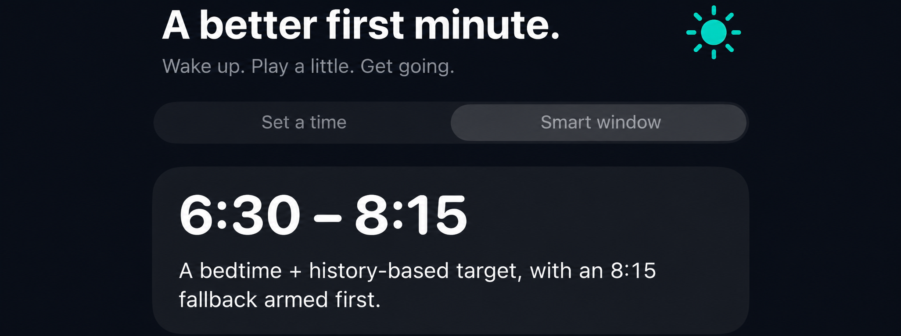

<p align="center">
  
</p>

<h1 align="center">Smart Wake</h1>

<p align="center"><strong>A better first minute.</strong><br>Wake up. Play a little. Get going.</p>

A native iPhone + Apple Watch prototype: choose a wake-up time, play a short original word, grouping or crossword game, and cancel the remaining reminders when you finish.

**Build-checked prototype. Keep a separate trusted alarm.** The portable suite passes 74 tests, and both iPhone/Watch simulator builds have passed with Xcode 26.6. These checks do not establish physical-device or overnight alarm reliability. See [CI results](https://github.com/aidandaly24/smart-wake/actions) and [validation details](docs/VALIDATION.md).

<p align="center">
  
</p>

<p align="center"><em>AI-edited preview based on an earlier iPhone build, with personal data removed. Current follow-up behavior is not shown.</em></p>

## What's implemented

- **Set a time:** a real iOS 26 AlarmKit alarm at the next occurrence of your chosen local time, followed by at most ten pre-scheduled one-minute reminders.
- **Smart window:** a bedtime and recent-history-informed target between **06:30 and 08:15**. The **08:15 fallback is scheduled first**. The fallback is followed by ten one-minute reminders, through 08:25; an earlier target can also have up to ten reminders before 08:15. The target does not move during the night.
- **Original rotating puzzles:** five-letter guessing, two groups of four, and an intersecting mini crossword. Choose daily rotation or a style before arming. Hints and unlimited attempts are available; progress survives relaunch. Existing memory-game sessions remain compatible. See [the game guide](docs/WAKE_GAMES.md).
- **Approved sunrise icon:** iPhone and Watch asset catalogs are included. See [safe icon integration](docs/ICON.md) for an already signed local project.
- **Emergency stop:** an always-visible way to cancel all this app's alarms. Failed cancellation remains visible and can be retried.
- **Watch companion:** explicit HealthKit sleep-history access, capability-gated overnight accelerometer recording, and user-triggered summary transfer to the paired iPhone. No workout trick, web service, or analytics.
- **Conservative fallbacks:** no bedtime means the latest fallback plus ten follow-ups; missing history uses a clearly disclosed eight-hour preference, not a claim that you have slept enough.

## Important limits

Apple's system **Stop** control always remains available. The app cannot force puzzle completion, stop users disabling permission, or guarantee minute-by-minute delivery under every device state. The finite reminder bounds are deliberate; this is not an infinite alarm loop.

This is **history-informed scheduling, not a live smart alarm**. HealthKit sleep stages may not be available overnight. Recorded motion is post-hoc data, not a sleep-stage classifier, and currently does not change the wake time. A watchOS smart-alarm extended runtime is bounded to 30 minutes; this prototype does not chain sessions or pretend it can silently wake at 06:30 and continue until 08:15.

Alarm dates are absolute once armed. A time-zone change is called out in the app; cancel and re-arm for the new local zone. There is no recurring daily schedule in v0.

## Open and build

Requirements: **Mac with Xcode 26 or later**, iOS 26+ iPhone, and watchOS 26+ Watch for the companion. Phone/Watch model compatibility and real-device behavior still need verification.

1. Open `SmartWake.xcodeproj`.
2. For each target, select your own signing team and unique bundle identifier. Keep the Watch bundle ID prefixed by the phone bundle ID. Update the Watch target's `COMPANION_APP_BUNDLE_IDENTIFIER` to match the phone ID.
3. Select the `SmartWake` scheme and a paired simulator or your iPhone. The iPhone target embeds `SmartWakeWatch`.
4. For device HealthKit testing, enable the HealthKit capability for the Watch target using your existing Apple development account. Do not purchase membership just to try the core tests.
5. Run, allow alarms explicitly, choose a near-future manual alarm, and follow `docs/DEVICE_TEST_PLAN.md` before relying on it overnight.

See [the device installation guide](docs/INSTALL.md) for signing, free Personal Team limits and the Developer Mode security steps. Apple currently supports Watch HealthKit for free developer accounts; exact signing still needs verification. Personal Team profiles expire after seven days. No account, credential, paid membership, or app installation is performed by this repository.

```sh
# Portable Foundation-only scheduling, DST and puzzle tests.
swift test

# Fresh checkouts only: regenerating replaces local project/signing customization.
# Do NOT run this on your customized project to apply an update.
python3 scripts/generate_project.py

# Structural/privacy smoke checks, runnable without Apple SDKs.
python3 scripts/validate_repository.py
python3 scripts/validate_puzzle_catalog.py

# On Mac/Xcode 26: compile both simulator targets without signing.
xcodebuild -project SmartWake.xcodeproj -scheme SmartWake -destination 'generic/platform=iOS Simulator' CODE_SIGNING_ALLOWED=NO build
xcodebuild -project SmartWake.xcodeproj -scheme SmartWakeWatch -destination 'generic/platform=watchOS Simulator' CODE_SIGNING_ALLOWED=NO build
```

The Xcode app schemes build the UI targets; the package's tests are run with `swift test`. The project generator requires no XcodeGen or third-party Python package.

## Privacy

Source code and synthetic fixtures are safe to publish; **your personal sleep, motion, bedtime and device data are not repository content**. The app reads HealthKit locally and transfers an explicit summary only to the paired iPhone. It creates no app-managed health-data file or server copy; WatchConnectivity retains the latest paired-device application context, which the phone can restore after relaunch. Apple Health/iCloud settings are separate from this app. The saved alarm/puzzle ledger contains alarm configuration and game state, is file-protected, and is excluded from backup. Watch locally stores only bedtime and recording-request metadata. No third-party assets, proprietary puzzle code, telemetry, API secrets or real health fixtures are included.

The Watch does not distinguish denied HealthKit read permission from an empty result. See `docs/ARCHITECTURE.md` for behavior, cancellation, recovery and current limitations.
